# Dashboards y BI con IA · ClickHouse

Ejemplos del curso de JMD Learning: levantas ClickHouse con Docker, cargas y limpias ventas con reglas propuestas por IA, y terminas con un tablero de ventas que se actualiza solo.

Solo necesitas **Docker Desktop**. Python, las librerías para leer Excel, PDF y Word, y el servidor del tablero vienen dentro de los contenedores. Por eso **los comandos son los mismos en Windows (PowerShell) y en Mac (Terminal)**.

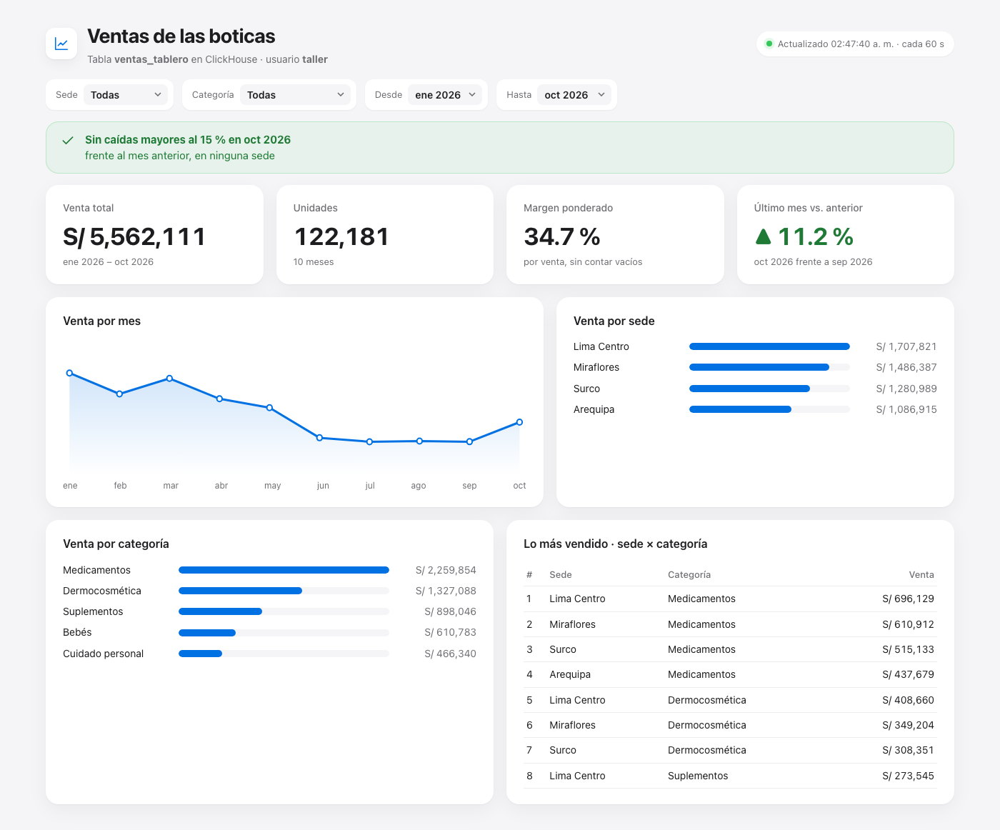

<sub>El tablero que construyes en la sesión 2, consultando ClickHouse en vivo.</sub>

Los datos son **ficticios**: ventas inventadas de cuatro boticas entre enero y octubre de 2026, con errores puestos a propósito para practicar la limpieza.

---

## 1. Prepara tu máquina (video 1)

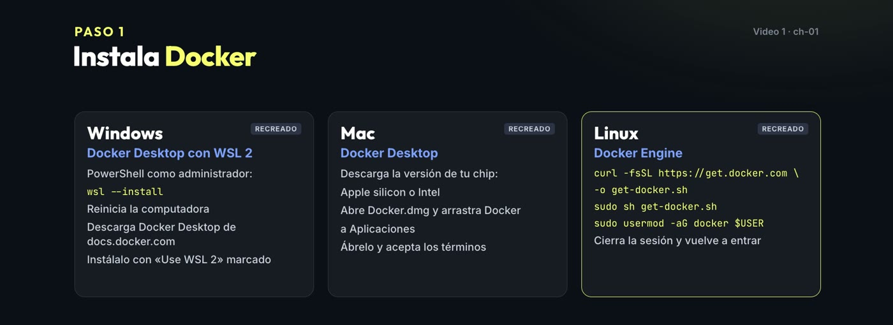

<sub>Lámina del video 1. Windows y Linux aparecen recreados; los pasos son los de docs.docker.com.</sub>

### Windows 10 u 11

1. Abre **PowerShell como administrador** y ejecuta:
   ```powershell
   wsl --install
   ```
   Reinicia la computadora cuando te lo pida.
2. Descarga e instala **Docker Desktop** desde <https://www.docker.com/products/docker-desktop/>. Durante la instalación deja marcada la opción **Use WSL 2**.
3. Abre Docker Desktop y espera a que diga **Engine running**.

### Mac

1. Descarga **Docker Desktop** desde <https://www.docker.com/products/docker-desktop/>. Elige **Apple Silicon** (M1, M2, M3, M4) o **Intel**, según tu Mac (menú Apple › Acerca de esta Mac).
2. Arrástralo a Aplicaciones, ábrelo y espera a que diga **Engine running**.

### Comprueba que funciona (Windows y Mac)

Abre una terminal nueva (PowerShell en Windows, Terminal en Mac):

```
docker version
docker run --rm hello-world
```

Si ves **Hello from Docker!**, estás listo.

## 2. Descarga este repositorio

Con Git:

```
git clone https://github.com/davrv93/clickhouse-bi-ejemplos.git
cd clickhouse-bi-ejemplos
```

Sin Git: en GitHub, botón **Code › Download ZIP**. Descomprímelo y entra a la carpeta con `cd`.

## 3. Crea tu archivo .env

| Windows (PowerShell) | Mac (Terminal) |
|---|---|
| `Copy-Item .env.example .env` | `cp .env.example .env` |

Es el único paso con un comando distinto en cada sistema. El `.env` guarda tu usuario y tu clave, y no se sube a GitHub.

## 4. Levanta todo

```
docker compose up -d
docker compose ps
```

La primera vez descarga las imágenes; tarda unos minutos. Cuando `clickhouse` diga **healthy**:

- Consola SQL de ClickHouse en el navegador: <http://127.0.0.1:8123/play> (usuario `taller`, clave `taller123`)
- Tablero de ventas: <http://127.0.0.1:8080> (muestra un error hasta que cargues los datos de la sesión 2)

> Usa siempre `127.0.0.1`. Docker publica los puertos solo en tu máquina, nadie de tu red puede entrar.

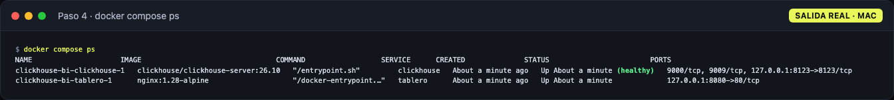

<sub>Así se ve cuando todo está arriba: `clickhouse` en **healthy**.</sub>

## 5. Cómo se ejecutan los pasos

Todo pasa por el contenedor **herramientas**:

```
docker compose run --rm herramientas <script.py> [argumentos]
```

La primera vez construye la imagen (un minuto). Para ver la lista de scripts:

```
docker compose run --rm herramientas
```

Los archivos que se generan quedan en la carpeta `salida/` del proyecto.

---

## Sesión 1 · Conecta, limpia y estructura

### Video 2 · Tu primer contenedor y la persistencia

Crea una tabla con una fila:

```
docker compose run --rm herramientas sql.py sql/sesion-1/02-persistencia.sql
```

Ahora borra el contenedor y vuelve a crearlo. Los datos viven en el **volumen**, no en el contenedor:

```
docker compose down
docker compose up -d
docker compose run --rm herramientas sql.py sql/sesion-1/02-persistencia.sql
```

`SELECT * FROM notas` sigue mostrando la fila (el `INSERT` agrega una segunda igual: eso también prueba que la primera sobrevivió).

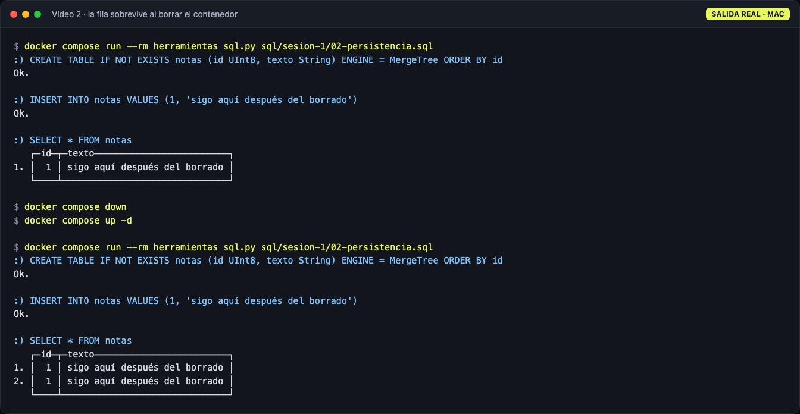

<sub>Después de `down` y `up`, la fila sigue ahí.</sub>

> `docker compose down -v` sí borra el volumen y **todos tus datos**. Úsalo solo si quieres empezar de cero.

Para mirar dentro del contenedor:

```
docker compose ps
docker compose logs clickhouse --tail 20
docker volume ls
```

### Video 3 · Cargar CSV y Excel con tipos correctos

```
docker compose run --rm herramientas sql.py sql/sesion-1/03-crear-ventas-crudas.sql
docker compose run --rm herramientas cargar.py ventas_crudas datos/ventas-sucio.csv
```

ClickHouse no lee `.xlsx`, así que el Excel se pasa primero a CSV:

```
docker compose run --rm herramientas excel_a_csv.py datos/archivos/ventas-lima-miraflores.xlsx salida/excel.csv
docker compose run --rm herramientas cargar.py ventas_excel salida/excel.csv
docker compose run --rm herramientas sql.py sql/sesion-1/03-verificar-carga.sql
```

Lo esperado: 6144 filas en `ventas_crudas`.

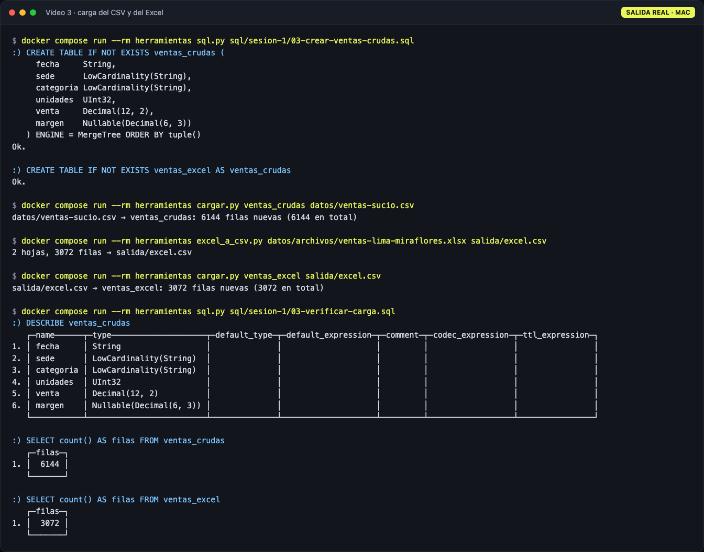

<sub>Tipos explícitos con `DESCRIBE` y el conteo de filas de cada carga.</sub>

### Video 4 · Limpieza con reglas de IA y verificación de totales

1. Mira qué está mal y saca el **perfil** de la tabla. El perfil tiene conteos y valores distintos, **no filas**: es lo único que verá la IA.
   ```
   docker compose run --rm herramientas sql.py sql/sesion-1/04-perfil.sql
   docker compose run --rm herramientas perfil_sql.py ventas_crudas
   ```
2. Pide las reglas a la IA. Puedes pegar `prompts/04-reglas-sql.txt` y el perfil en Claude o DeepSeek, o, si pusiste tu `DEEPSEEK_API_KEY` en `.env`:
   ```
   docker compose run --rm herramientas reglas_ia.py salida/perfil-sql.json prompts/04-reglas-sql.txt salida/reglas-sql.json
   ```
   Sin llave no pasa nada: `datos/reglas-sql.json` trae las reglas que propuso la IA en el curso.
3. Aplica las reglas. Pruébalo primero sin corrección (`aplicar_sql.py` a secas) y mira las categorías: la regla de la IA deja «BebÉs» y «DermocosmÉtica» porque no maneja bien las tildes, y cambia «Cuidado personal» por «Cuidado Personal». La corrección humana de `datos/correccion-humana.json` lo arregla:
   ```
   docker compose run --rm herramientas aplicar_sql.py --correccion datos/correccion-humana.json
   docker compose run --rm herramientas sql.py sql/sesion-1/04-verificar-limpieza.sql
   ```
   El control debe decir **CUADRA**: la venta limpia es la cruda menos lo que sumaban las filas repetidas.

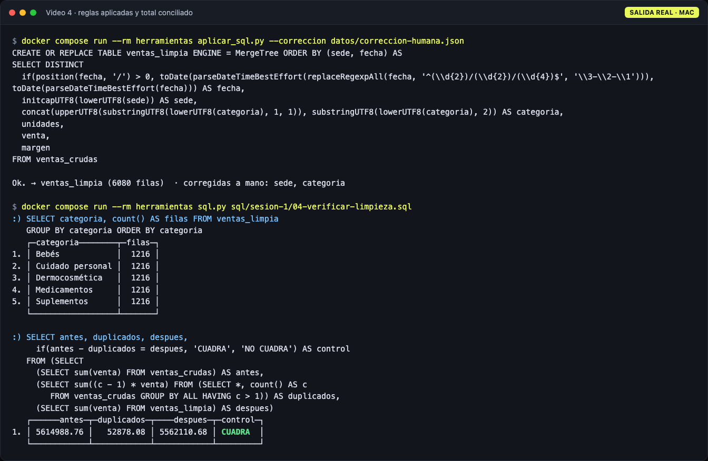

<sub>Con la corrección humana quedan cinco categorías limpias y el total cuadra.</sub>

---

## Sesión 2 · De tus datos al dashboard

### Video 5 · De las preguntas de negocio a los KPIs

Teoría. Antes de cualquier gráfico, llena esta plantilla con tus preguntas:

| Pregunta de negocio | Indicador | Gráfico | Acción si sale mal |
|---|---|---|---|
| ¿Cuánto vendemos? | Venta total | Número grande | — |
| ¿Vamos mejor o peor? | Venta por mes | Línea | Revisar el mes que cae |
| ¿Qué sede pesa más? | Venta por sede | Barras ordenadas | Reforzar la sede baja |
| ¿Ganamos lo suficiente? | Margen ponderado | Número grande | Revisar precios |

### Video 6 · Importar Excel, PDF y Word

Junta los tres reportes de `datos/archivos/` (un Excel, un PDF de 42 páginas y un Word) en una sola tabla:

```
docker compose run --rm herramientas extraer.py
```

Resultado: `salida/juntos.csv` con 6144 filas.

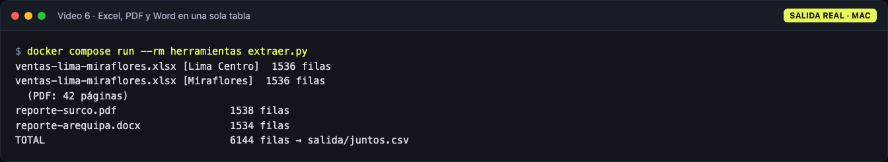

<sub>Las tres fuentes juntas en una sola tabla.</sub>

### Video 7 · Reglas de IA para unir fuentes distintas

```
docker compose run --rm herramientas perfil_csv.py
docker compose run --rm herramientas aplicar.py
```

`aplicar.py` usa las reglas ya revisadas de `datos/reglas-ia.json` y termina con el **cuadre** del total. Para pedir reglas nuevas con tu llave de DeepSeek:

```
docker compose run --rm herramientas reglas_ia.py salida/perfil.json prompts/07-reglas.txt salida/reglas-ia.json
docker compose run --rm herramientas aplicar.py --reglas salida/reglas-ia.json
```

### Video 8 · Modelar las tablas en ClickHouse

```
docker compose run --rm herramientas sql.py sql/sesion-2/08-crear-ventas-tablero.sql
docker compose run --rm herramientas cargar.py ventas_tablero salida/limpio.csv
docker compose run --rm herramientas sql.py sql/sesion-2/08-revisar-modelo.sql
```

### Video 9 · Las consultas clave del tablero

```
docker compose run --rm herramientas sql.py sql/sesion-2/09-consultas-del-tablero.sql
```

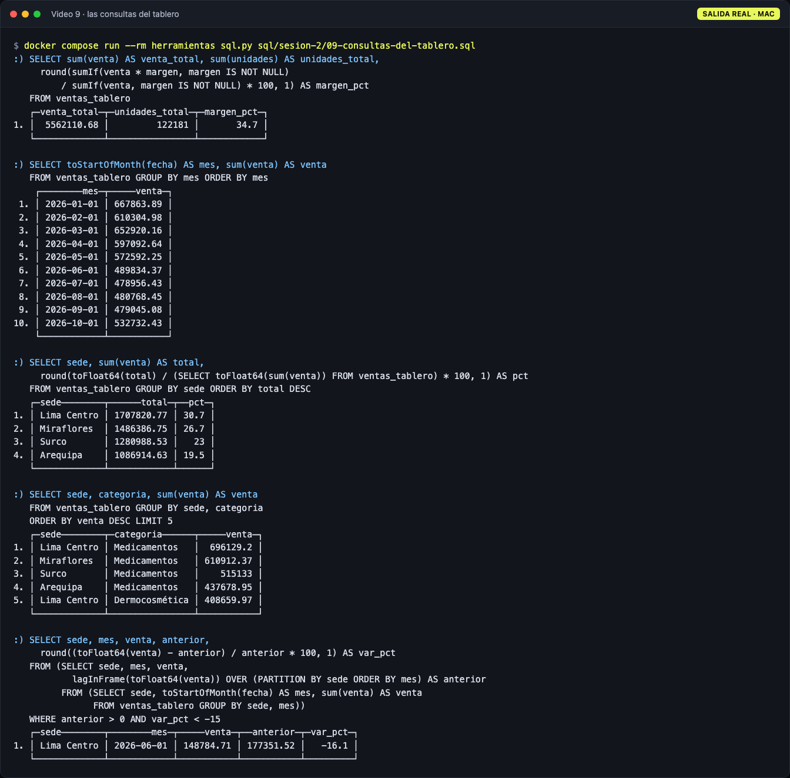

<sub>Las cinco consultas que alimentan el tablero. La última detecta la caída de Lima Centro en junio (−16.1 %).</sub>

### Video 10 · El dashboard estilo Apple

Abre <http://127.0.0.1:8080>. El tablero es un solo archivo, `tablero/index.html`, hecho con el prompt de `prompts/10-tablero.txt`. Consulta ClickHouse en vivo por su API HTTP.


<sub>Fondo claro, un solo acento azul y los datos de ClickHouse.</sub>

### Video 11 · Filtros y alertas

El tablero ya trae los filtros de sede, categoría y período, y la alerta de caídas mayores al 15 % (prompt en `prompts/11-filtros-y-alerta.txt`). La consulta de la alerta para un mes:

```
docker compose run --rm herramientas sql.py sql/sesion-2/11-alerta-junio.sql
```

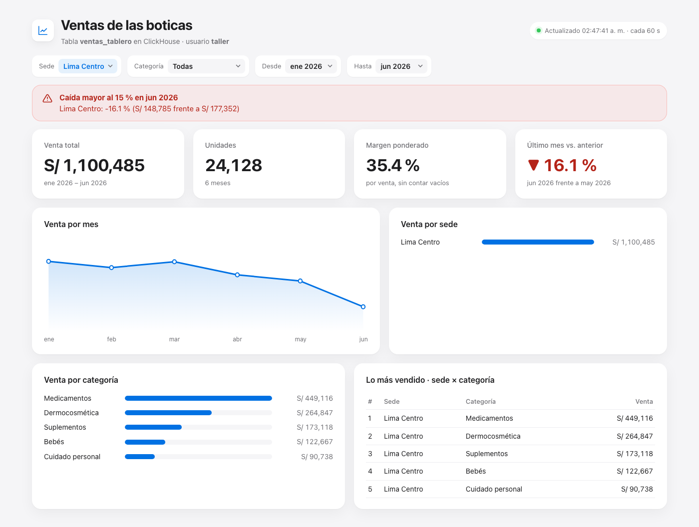

<sub>Filtro de sede Lima Centro y período hasta junio: se enciende la alerta.</sub>

### Video 12 · Refresco automático

```
docker compose run --rm herramientas sql.py sql/sesion-2/12-resumen-mensual.sql
docker compose run --rm herramientas sql.py sql/sesion-2/12-probar-refresco.sql
```

Espera hasta un minuto y comprueba que la venta de prueba entró sola al resumen (el archivo la borra al final):

```
docker compose run --rm herramientas sql.py sql/sesion-2/12-ver-refresco.sql
```

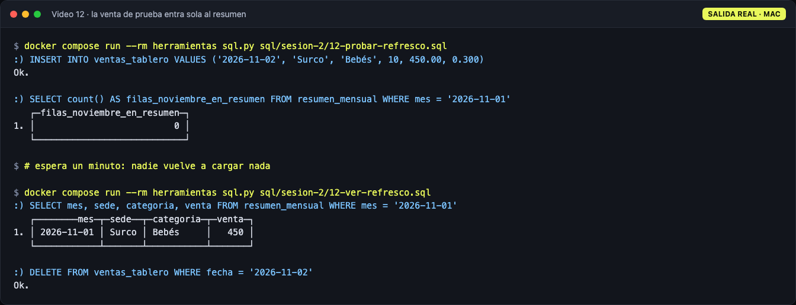

<sub>Nadie recarga nada: la vista materializada se refresca cada minuto.</sub>

Tablero leyendo el resumen: <http://127.0.0.1:8080/?fuente=resumen_mensual>

### Video 13 · Publicar o compartir sin regalar tu clave

```
docker compose run --rm herramientas sql.py sql/sesion-2/13-usuario-lector.sql
docker compose run --rm herramientas sql.py sql/sesion-2/13-pruebas-lector.sql --usuario lector --clave lector2026 --seguir
```

La prueba 1 responde y las pruebas 2 y 3 fallan con `ACCESS_DENIED`: eso es lo correcto.

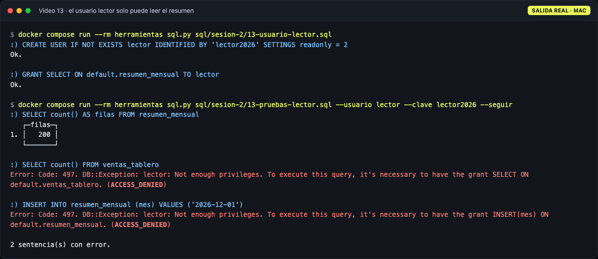

<sub>Lo que debes ver: una lectura que funciona y dos intentos bloqueados.</sub>

Tablero con el usuario de solo lectura:

<http://127.0.0.1:8080/?fuente=resumen_mensual&usuario=lector&clave=lector2026>

Cambia `lector2026` por una clave tuya antes de compartir nada.

### Video 14 · Caso final de punta a punta

Los seis pasos en un solo comando: extraer, perfil, reglas, aplicar y conciliar, cargar y refrescar.

```
docker compose run --rm herramientas pipeline.py
```

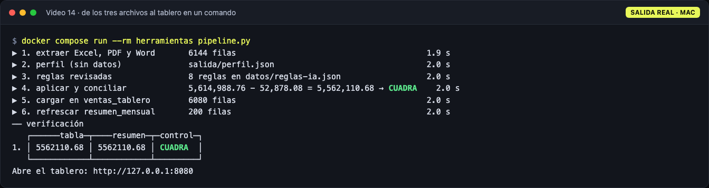

<sub>Los seis pasos en un comando. El total del tablero y el del resumen coinciden.</sub>

Para tus propios datos, reemplaza los archivos de `datos/archivos/` y ajusta en `extraer.py` cómo se leen. Las columnas deben quedar como `fecha, sede, categoria, unidades, venta, margen`.

---

## Problemas frecuentes

- **`docker: command not found` o «Cannot connect to the Docker daemon»**: abre Docker Desktop y espera a que diga Engine running.
- **«port is already allocated»**: otro programa usa el 8123 o el 8080. Cambia `CH_PUERTO` o `TABLERO_PUERTO` en `.env` y vuelve a `docker compose up -d`. Si cambias `CH_PUERTO`, la consola Play queda en ese puerto; el tablero no cambia.
- **Windows: «WSL 2 installation is incomplete»**: ejecuta `wsl --update` en PowerShell como administrador y reinicia Docker Desktop.
- **Windows: no uses `>` para guardar la salida de un script.** PowerShell cambia la codificación del archivo. Los scripts ya escriben sus archivos en `salida/`.
- **Windows: no uses `curl` en PowerShell para hablar con ClickHouse.** En PowerShell 5, `curl` es otro comando. Usa `cargar.py` y `sql.py`, o escribe `curl.exe`.
- **Empezar de cero**: `docker compose down -v` borra el volumen con todos los datos. Luego `docker compose up -d`.

## Sobre las imágenes

Las capturas de terminal y del tablero son salidas reales de este repositorio en una Mac, con los mismos comandos de esta guía. En Windows la salida es la misma; cambia solo el aspecto de la ventana.

## Qué hay en el repositorio

```
docker-compose.yml       ClickHouse 26.10, el tablero (nginx) y las herramientas
.env.example             usuario, clave, puertos y llave opcional de DeepSeek
datos/                   ventas-sucio.csv, los 3 reportes y las reglas ya revisadas
herramientas/            scripts de Python que corren dentro del contenedor
sql/sesion-1, sesion-2   el SQL de cada video, numerado igual que los videos
prompts/                 los prompts de reglas, del tablero y de filtros
tablero/                 el tablero de un solo archivo (index.html)
docs/img/                las imágenes de esta guía
```

## Licencia

Código bajo licencia MIT (archivo `LICENSE`). Los datos son ficticios y se pueden usar libremente para practicar.
